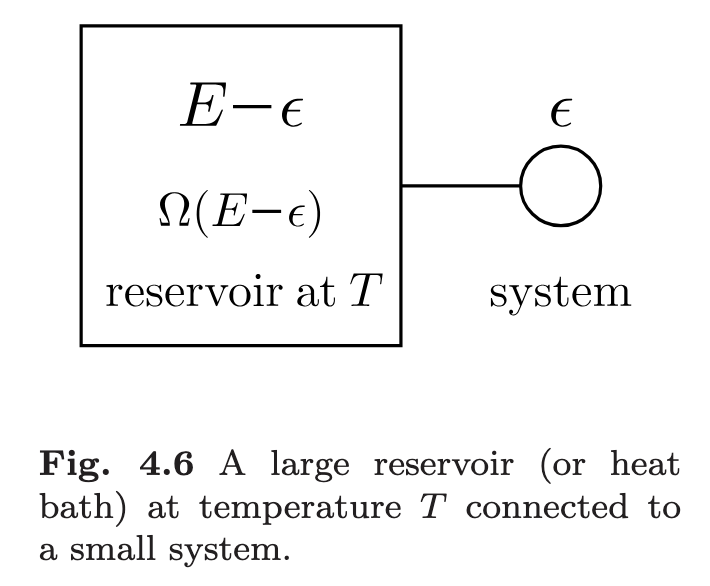

# Chapter 1: Preliminaries

## 1.1 Introduction

The subject of thermal physics involves studying **assemblies of large numbers of atoms**.

Hence, to make progress in thermal physics, it is neccessary to make approximations and deal with the **statistical properties** of the system.

### 1.1.1 What is a mole?

A mole is defined as the quantity of a substance that contains as many elementary entities (atoms, molecules, ions, etc.) as there are atoms in 12 grams of carbon-12. $1 \, \mathrm{mol} = 6.022 \times 10^{23}$ entities.

### 1.1.2 The thermodynamic limit

假想一个下雨天，雨滴落在棚顶上。棚顶尺寸越小，雨滴施加给棚顶的力就越不稳定（涨落越大）。

$$
\mathrm{Pressure} = \frac{\mathrm{Force}}{\mathrm{Area}}
$$

- The average pressure due to the falling raindrops will not change as the area of the roof increases
- The fluctuations in the pressure will decrease

Consider now the molecules of a gas which are bouncing around in a container.

- The number of molecules in a container of gas is extremely large
- The fluctuations can be ignored and the pressure of the gas appears to be **completely uniform**.

!!! note "Thermodynamic limit"
    $$
    N \to \infty, \quad V \to \infty, \quad \rho = \frac{N}{V} = \text{constant}
    $$

!!! question "思考：为什么引入热力学极限？"
    1. 因为涨落足够小，才能用平均值来描述系统的行为
    2. any other reason？见下一个思考题！

!!! info "Extensive and intensive variables"
    - **Intensive variables（强度量）**: Variables which are independent of system size/mass
    - **Extensive variables（广延量）**: Variables which scale with system size/mass

    !!! note "功共轭变量"
        对于一个强度量，总有一个广延量与之共轭，二者量纲的乘积是能量。

        | Intensive variable | Extensive variable | Differential form of work |
        |:------------------:|:------------------:|:-------------------------:|
        | $T$ | $S$ | $T dS$ |
        | $p$ | $V$ | $-p dV$ |
        | $\mu$ | $N$ | $\mu dN$ |

!!! question "思考：能量是广延量吗？"
    分为动能和势能两部分来考虑。对于动能来说，动能是粒子的运动，显然粒子数越多动能越大。对于势能来说，从微观视角看势能是分子间的相互作用，即

    $$
    U = \sum_{i<j} V(\vec{r}_{ij})
    $$

    于是这个问题会与作用力的类型有关。

    - 如果是**短程**作用力，

### 1.1.3 Ideal gas

- Boyle's law: $pV = \text{constant}$ at constant $T$
- Charles's law: $V \propto T$ at constant $p$
- Gay-Lussac's law: $p \propto T$ at constant $V$
- Avogadro's law: $V \propto N$ at constant $T$ and $p$

$$
pV = Nk_B T
$$

!!! question "Why do we call it "ideal"?"
    1. We assume that there are **no intermolecular forces**, sothat the molecules are not attracted to each other
    2. We assume that molecules are **point-like** and have **zero size**

- The ideal gas equation forms the basis of much of our study of classical thermodynamics
- The ideal gas law doesn't describe all important gases

### 1.1.4 Combinatorial problems

!!! example "Ten atoms of two states"
    Imagine that a certain system contains ten atoms. Each of these atoms can exist in one of **two states**, according to whether it has zero units or one unit of energy.

    - $r$-th

## 1.2 Heat

### 1.2.1 A definition of heat

!!! question "热是什么？"
    - 热质说：热是一种物质（caloric），可以流动
      - 否定：摩擦生热，物质不能源源不断产生！
    - 热功当量实验（焦耳）：电能可以转化为热能

    :point_right: 热是能量的一种形式

**Heat** is *thermal energy* in transit. 热是热能的转移.

热量是过程量，与过程有关，所以其微分记为 $\delta Q$

### 1.2.2 Heat capacity

一个物体是装不了多少“热量”的，因为热量是过程量。更合适的叫法可能是 "energy capacity"，只不过热容的名字叫习惯了。

$$
C = \frac{\delta Q}{dT}
$$

不同的加热方式，$C$ 显然也不同。比如为了让一团气体的温度升高 $1 \, \mathrm{K}$，固定体积加热所需的热量会比固定压强加热所需的热量少，因为后者的气体在膨胀过程中还要克服大气压力做功。所以等压热容 $C_p$ 会大于等体热容 $C_V$。

## 1.3 Probability

!!! example "Random walk (1D)"
    > 布朗运动，爱因斯坦论文

    一个人等概率地往左或往右走，每步步长为 $L$. 设总距离 $Y = \sum_{i = 1}^n x_i$, 其中 $x_i \in \{-L, L\}$.

    $$
    \braket{Y} = \left\langle \sum_{i = 1}^n x_i \right\rangle = \sum_{i = 1}^n \braket{x_i} = 0 
    $$

    来考虑人离原点多远，也就是计算方差

    $$
    \braket{Y^2} = \left\langle \bigg( \sum_{i = 1}^n x_i \bigg)^2 \right\rangle = \sum \braket{x_i^2} = n L^2
    $$

    这里利用了每一步相互独立，$\braket{x_i x_j} = 0, \, i \neq j$. 如果每走一步花费的时间为 $\Delta t$，总时间为 $t = n \Delta t$，则

    $$
    \braket{Y^2} = \textcolor{orange}{\frac{L^2}{\Delta t}} t \sim t
    $$

    定义扩散系数

    $$
    D = \frac{L^2}{\Delta t}
    $$

    实验测量扩散系数的方法

## 1.4 Temperature and the Boltzmann factor

### 1.4.1 Thermal equilibrium

两个物体接触，热量自发从高温物体流向低温物体，直到两者达到相同的温度。这个过程称为热化（thermalization），使得两者达到**热平衡**（thermal equilibrium）**.

!!! note "热力学第零定律"

### 1.4.2 Thermometer

### 1.4.3 The microstates and macrostates

系统的宏观性质可以用微观态的数量表示，而各个微观态是**等概率**发生的。**系统最可能出现的宏观态，是对应微观态数目最多的状态**。

!!! tip "Crucial insight"
    **A system will appear to choose a macroscopic configuration that maximizes the number of microstates.**

    based on the following assumptions:

    - Each one of the possible microstates of a system is equally likely to occur.（**{==等概率假设==}**）
    - The system's internal dynamics are such that the microstates of the system are continually changing.（事实）
    - Given enough time, the system will explore all possible microstates and spend an equal time in each of them.（**{==各态历经假设==}**）

    :point_right: {==系统等概率地、连续地、等时地遍历每一种微观态。==}

为了定量描述，记系统所有可能的微观态数为 $\Omega$. 如果一个系统的能量为 $E$，则它的微观态数目为 $\Omega(E)$. 即微观态数目是能量的函数。

### 1.4.4 A statistical definition of temperature

设有两个与环境孤立的热系统，它们相互有热接触，能量分别为 $E_1, E_2$. 第一个系统的微观状态数是 $\Omega_1(E_1)$，第二个系统的微观状态数是 $\Omega_2(E_2)$。整个系统的微观状态数就是 $\Omega = \Omega_1(E_1) \, \Omega_2(E_2)$

对其中一个系统做出无限小的变化，对 $E_1$ 求极值

$$
\frac{\partial}{\partial E_1} (\Omega_1(E_1) \, \Omega_2(E_2)) = 0
$$

即

$$
\Omega_2 (E_2) \frac{\partial \Omega_1(E_1)}{\partial E_1} + \Omega_1 (E_1) \frac{\partial \Omega_2(E_2)}{\partial E_2} \cdot \frac{\partial E_2}{\partial E_1} = 0
$$

总能量不变，有 $\mathrm{d} E = \mathrm{d} E_1 + \mathrm{d} E_2 = 0$，所以 $\frac{\partial E_2}{\partial E_1} = -1$. 代入上式得

$$
\frac{\partial \ln \Omega_1(E_1)}{\partial E_1} = \frac{\partial \ln \Omega_2(E_2)}{\partial E_2}
$$

满足这个条件时，微观状态数达到最大。

定义温度 $T$：

$$
\begin{equation} \label{eq:temp_stat_def}
    \boxed{
        \frac{1}{k_B T} := \frac{\partial \ln \Omega(E)}{\partial E}
    }
\end{equation}
$$

其中 $k_B$ 是玻尔兹曼常数，$k_B = 1.3807 \times 10^{-23} \, \text{J/K}$. 此即为统计物理中温度的定义。

!!! question "思考"
    1.  该定义是否与热力学自洽？    
        
        ??? tip "解答"
            热力学第一定律：

            $$
            \mathrm{d} U = \mathrm{d}\kern{-4.7pt}\bar{\small\phantom{q}}\kern{0.8pt} Q + \mathrm{d}\kern{-4.7pt}\bar{\small\phantom{q}}\kern{0.8pt} W
            $$

            热力学温标：

            $$
            \mathrm{d} S = \left(\frac{\mathrm{d} Q}{T}\right)_{\text{rev}}
            $$

    2.  可以有负的温度吗？
        > 什么情况会使得能量增加，微观状态数减少？

        ??? tip "解答"
            需要使用统计力学对于温度的定义去理解：

            $$
            \frac{1}{k_B T} = \frac{\partial \ln \Omega(E)}{\partial E}
            $$

    

### 1.4.5 Ensembles

!!! info "前置知识"
    对于 $N$ 个粒子的经典力学系统，我们可以通过哈密顿量的正则方程得知系统的演化：

    $$
    \begin{equation*}
        \left \{
            \begin{aligned}
                \dot{q}_i &= \frac{\partial H(q_i, p_i)}{\partial p_i} \\
                \dot{p}_i &= -\frac{\partial H(q_i, p_i)}{\partial q_i}
            \end{aligned}
        \right.
    \end{equation*}
    $$

    在坐标 $(q_i, p_i)$ 中，一个点代表一个粒子的状态。不同点对应着不同时间下该粒子的状态，连起来就是一条轨迹，由正则方程给出。所有粒子的状态 $\vec{q} = (q_1, q_2, \ldots, q_N), \, \vec{p} = (p_1, p_2, \ldots, p_N)$ 在相空间（一个高维空间）$(\vec{q}, \vec{p})$ 中的轨迹就是系统的演化。经典力学、电动力学、量子力学都遵循这样的范式。

    :disappointed: 但到了大量粒子构成的系统（$N \sim 10^{23}$），上述范式在实际计算中不可行！

    :bulb: Gibbs 提出，我们干脆不去关心时间的演化，把相空间中的各个点对应的系统状态看作是系统的一份份“副本”，我们转而去关心这些副本的分布情况。

根据系统的限制条件，可以将系综分类如下：

- **微正则系综**（Microcanonical Ensemble）：系统与外界没有能量交换，总能量 $E$、粒子数 $N$、体积 $V$ 都是固定的。
- **正则系综**（Canonical Ensemble）：系统与外界有能量交换，但粒子数 $N$ 和体积 $V$ 是固定的，温度 $T$ 是固定的。
- **巨正则系综**（Grand Canonical Ensemble）：系统与外界有能量和粒子交换，但体积 $V$ 和温度 $T$ 是固定的，化学势 $\mu$ 是固定的。

### 1.4.6 Canonical ensemble

考虑一个复合的孤立系统，里面有两个部分彼此交换热量：
- 一个是具有很大能量的热库（**reservoir**, aka. heat bath），温度视为恒定
- 另一个是具有很小能量的系统（system），作为我们考虑的对象。

设总能量为 $E$，系统的能量为 $\epsilon$，则热库的能量为 $E - \epsilon$.

由于系统很小，{++假设它只有一个微观状态++}[^1]。复合系统整体是孤立的，所以（由等概率原理）它的微观状态是等概率的。

我们想知道小系统处于能量 $\epsilon$ 的概率为多少，这等价于求复合系统在此情况的微观状态数。设热库的微观状态数为 $\Omega(E - \epsilon)$，则

$$
P(\epsilon) \propto \Omega(E - \epsilon) \times 1.
$$

由于 $\epsilon \ll E$，对 $\ln \Omega(E - \epsilon)$ 做泰勒展开：

$$
\ln \Omega(E - \epsilon) = \ln \Omega(E) - \frac{\partial \ln \Omega(E)}{\partial E} \epsilon + \ldots
$$

使用温度定义式 \eqref{eq:temp_stat_def}，得

$$
\ln \Omega(E - \epsilon) = \ln \Omega(E) - \frac{\epsilon}{k_B T} + \ldots
$$

略去高阶项就得到

$$
\Omega(E - \epsilon) \approx \Omega(E) e^{-\epsilon / k_B T}
$$

因此

$$
P(\epsilon) \propto e^{-\epsilon / k_B T}
$$

[^1]: 这个假设是可以去掉的，结论仍然成立。设小系统的微观状态数为 $\Omega_1(\epsilon)$，热库的微观状态数为 $\Omega_2(E - \epsilon)$，则复合系统的微观状态数为 $\Omega_1(\epsilon) \, \Omega_2(E - \epsilon)$，所以

    $$
    P(\epsilon) \propto \Omega_1(\epsilon) \, \Omega_2(E - \epsilon)
    $$

系统的温度是固定的，但能量却是有一个分布的！这被称为**玻尔兹曼分布**（**Boltzmann distribution**, aka. canonical distribution），$e^{-\epsilon/k_B T}$ 称为**玻尔兹曼因子**（Boltzmann factor）.

若一个系统与热库接触，微观状态 $r$ 对应的能量为 $E_r$，则该微观状态出现的概率为

$$
P(r) = \frac{e^{-E_r/k_B T}}{\sum_r e^{-E_r/k_B T}}. 
$$

分母的归一化因子称为**配分函数**（partition function）：

$$
Z = \sum_r e^{-E_r/k_B T} = \sum_r e^{-\beta E_r}.
$$

常常记 $\beta = \frac{1}{k_B T}$.

### 1.4.7 Applications of the Boltzmann distribution

!!! example "Two state system（两态系统）"
    系统只存在两种状态：一种是能量为 $0$，另一种能量为 $\epsilon > 0$. 由于 $P(\epsilon) \propto e^{-\epsilon/k_B T}$，所以

    $$
    P(0) = \frac{1}{1 + e^{-\epsilon/k_B T}}, \quad P(\epsilon) = \frac{e^{-\epsilon/k_B T}}{1 + e^{-\epsilon/k_B T}}.
    $$

    于是系统的平均能量为

    $$
    \braket{E} = \frac{\epsilon e^{-\epsilon/k_B T}}{1 + e^{-\epsilon/k_B T}}.
    $$

!!! question "为什么算一个期望值就能说成是系统的宏观量呢？"
    物理上测量一个宏观量，是多次测量取平均值，也就是取**时间平均**：

    $$
    \bar{\phi} = \frac{1}{\tau} \int_{t_0}^{t_0 + \tau} \phi \Big[\vec{r}^N(t), \vec{p}^N(t) \Big] \, dt
    $$

    取系综平均

    $$
    \braket{\phi} = \int P(\vec{r}^N, \vec{p}^N) \, \phi(\vec{r}^N, \vec{p}^N) \, d\vec{r}^N d\vec{p}^N
    $$

    二者是等价的（ergodic hypothesis）：在长时间内，时间平均等于系综平均。

!!! tip "重要概念回顾"
    -   **{==热力学平衡态==}**：系统在长时间后不再随时间变化，包括温度、压力、化学势等宏观量
    -   **{==状态空间==}**：描述系统（宏观）态变量（state variables）的空间
        - 如对于气体，$(p, V, T)$
        > 只有满足平衡态的条件，系统的状态才能用一个画在状态空间中的点来表示。
    -   **{==等概率原理==}**：{++处于平衡态的孤立系统++}，一切可能的微观状态出现的概率相等（后文会提到）
    -   **{==相空间==}**：$3N$ 个广义坐标和 $3N$ 个广义动量构成的 $6N$ 维空间
    -   **{==统计系综==}**：系统在不同时刻的代表点，被想象成许多{++具有相同宏观性质的系统++}处于不同微观状态的代表点。这些想象系统的集合称为统计系综，简称**系综**.