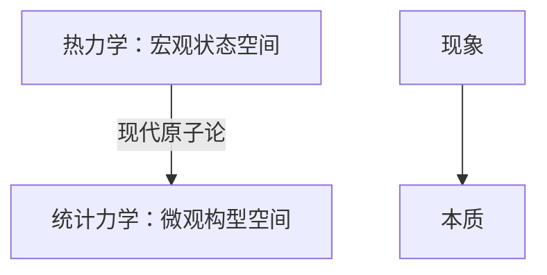

# Introduction

!!! abstract "Content"
    - Thermodynamics（唯象理论）
    - Kinetic theory of gases（试图从微观角度解释气体的宏观性质）
    - Statistical mechanics（一般性框架）

    专题：

    - Beyond the ideal gas
      - 硬球
      - 相变
    - Special topics

## 发展脉络

### Thermodynamics

**Thermodynamics**: deals with **macroscopic properties**, without worrying about the underlying microscopic physics.

- Robert Mayer (1814-1878)
- James Joule (1818-1889)
  - 焦耳定律
- Rudolf Clausius (1822-1888)
  - 热力学第二定律
- Lord Kelvin (1824-1907)
- Walter Nernst (1864-1941)
  - 电化学、热力学第三定律

### Kinetic theory

**Kinetic theory of gases**: determines the properties of gases by considering **probablity distributions** associated with the motions of individual molecules.

- James Clerk Maxwell (1831-1879)
- Ludwig Boltzmann (1844-1906)

> 当时的科学家攻击玻尔兹曼：热力学第二定律是基于气体分子碰撞，而气体分子的运动又由牛顿力学支配。牛顿力学是可逆的，为什么热力学第二定律又是不可逆的？
>
> 2026 Fields Medal, 邓煜：微观可逆可以严格推导得出宏观不可逆

### Statistical mechanics

**Statistical mechanics**: begins with describing the individual **microscopic states** of a system and then uses **statistical methods** to derive the macroscopic properties.

**系综理论**：{++平衡态++}统计物理的理论框架

- Ludwig Boltzmann (1844-1906)
- Josiah Willard Gibbs (1839-1903)

!!! info "平衡态"
    平衡态是指系统的宏观变量不随时间改变，也就是处于静态。但系统内部的微观状态仍然在不断变化。

    生命系统是典型的非平衡态。

    > Schrödinger, *What is Life?*：生命通过与外界交互保持自身低熵。
    > 吃饭是为了摄入负熵，因为蛋白质等人体所需的物质是有序的。

## 现代原子论

- 道尔顿：原子
- J. J. Thomson：电子
- Albert Einstein：提出布朗运动解释
  - 《分子大小的新测定方法》

!!! tip "神奇的事情..."
    一团气体，分子数量巨大，是一个极高维的系统。但我们只需要用 3 个物理量描述它：$T, V, p$

    :bulb: 说明一定有底层的物理规律存在！

!!! tip "一个全新的思路"
    经典力学研究一两个物体的运动规律，三体运动已经非常复杂；它关注的是系统演化轨迹（不论是经典还是量子），{++是和时间相关的++}。
    统计物理的研究对象是大量粒子组成的系统（$\sim 10^{23}$），不可能追踪每一个粒子的轨迹！

    :bulb: 如果我们不去关注单个粒子，而是**关注系统整体的状态分布** $\implies$ **系综**

    将系统“复制”为若干个副本，粒子的性质、数量等都是全同的，而每个粒子的微观状态可能不同。这些状态的先后，在统计上是不重要的，{++与时间无关++}。

> Glass（广义）：非晶体的固体
>
> 液体和固体的本质区别是什么？

