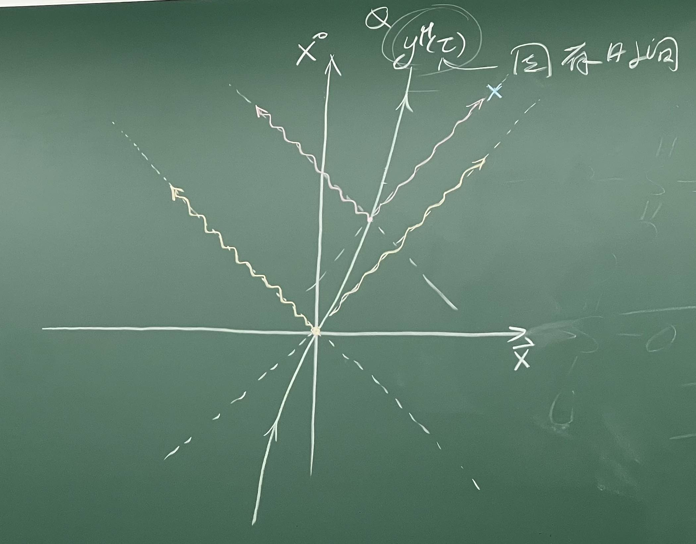

> 2026/06/16 10:00
> 
> - 任意带电质点的电磁辐射

{width=90%}

已知质点任意时刻的位置 $y^\mu(\tau)$，质点在任意时刻沿着自己的光锥发出电磁波。观测者在某地 $\vec{x}$ 观测到的电磁波是质点在某固有时刻 $\tau^*$ 发出的电磁波，我们需要沿着它的光锥追踪

$$
A^\mu(x) = \frac{1}{4 \pi} \int d^3 \vec{x}' \frac{I^\mu(x^0 - |\vec{x} - \vec{x}'|, \vec{x}')}{|\vec{x} - \vec{x}'|}
$$

其中

$$
I^\mu(x^0 - |\vec{x} - \vec{x}'|, \vec{x}') = Z Q \int d \tau \frac{d y^\mu(\tau)}{d \tau} \, \delta\big(x^0 - |\vec{x} - \vec{x}'| - y^0(\tau)\big) \, \delta^{(3)}\big(\vec{x}' - \vec{y}(\tau)\big)
$$

代入电磁势，把 $\vec{x}'$ 积分掉，替换为 $\vec{y}(\tau)$；同时记 $\dot{y}^\mu \equiv \frac{d y^\mu(\tau)}{d \tau} = \frac{(c, \vec{v})}{\sqrt{1 - |\vec{v}|^2/c^2}}$，其中 $d \tau = \sqrt{1 - |\vec{v}|^2/c^2} \, dt$

$$
A^\mu(x) = \frac{Z Q}{4 \pi} \int d \tau \frac{1}{\left|\vec{x} - \vec{y}(\tau)\right|} \dot{y}^\mu(\tau) \, \delta\big(x^0 - |\vec{x} - \vec{y}(\tau)| - y^0(\tau)\big)
$$

$\delta$ 函数内的项是关于 $\tau$ 的函数。利用 $\delta$ 函数的性质 $\delta(f(\tau)) = \sum_i \frac{\delta(\tau - \tau_i)}{|f'(\tau_i)|}$ 简化上式。先计算

$$
\begin{aligned}
    \frac{d}{d \tau} \Big(x^0 - |\vec{x} - \vec{y}(\tau)| - y^0(\tau)\Big) &= - \dot{y}^0 - \frac{d |\vec{x} - \vec{y}(\tau)|}{d \tau} = - \dot{y}^0 + \frac{\big(\vec{x} - \vec{y}(\tau)\big) \cdot \dot{\vec{y}}}{\left|\vec{x} - \vec{y}(\tau)\right|} \\
    &= \frac{- \dot{y}^0 \left|\vec{x} - \vec{y}(\tau)\right| + \big(\vec{x} - \vec{y}(\tau)\big) \cdot \dot{\vec{y}}}{\left|\vec{x} - \vec{y}(\tau)\right|}
\end{aligned}
$$