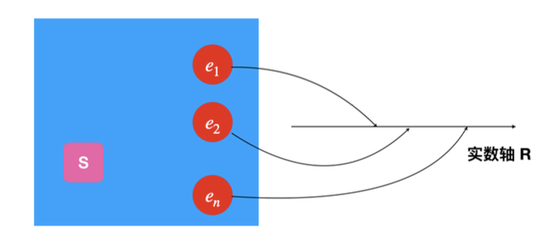

# 蒙特卡洛方法

!!! info "前言"
    - 起源：曼哈顿计划
        - 计算中子在非均匀介质中的散射和运输问题
    - Metropolis, Ulam

## 概率统计回顾

### 古典概率

- **随机试验**
    - 可以在相同条件下重复进行
    - 每次试验的结果不止一个，但事先知道所有可能的结果
    - 每次试验的结果不确定
- **样本点** $e$：随机试验的每个可能结果
- **样本空间** $S$：随机试验的所有可能结果的集合
- **随机事件** $A$：样本空间 $S$ 的子集

对于样本空间的子集（随机事件） $A$，赋予一个实数 $P(A)$，称为事件 $A$ 的概率，满足

1. 非负性：$P(A) \ge 0$
2. 规范性：$P(S) = 1$
3. 可列可加性：对于互补相容的事件列 $A_1, A_2, \ldots$，$A_i \cap A_j = \varnothing$，有

$$
P\left(\bigcup_{i=1}^{n} A_i\right) = \sum_{i=1}^{n} P(A_i)
$$

### 贝叶斯公式

-   全概率公式
    - 利用互斥完备集合 $\{A_i\}$，可以分解任意随机事件 $B$ 的概率至 $A_i$ 下的条件概率：
    
    $$
    P(B) = \sum_{i=1}^n P(B|A_i) \cdot P(A_i)
    $$

-   贝叶斯公式

    $$
    P(A_i|B) = \frac{P(A_i B)}{P(B)} = \frac{P(B|A_i) P(A_i)}{\sum_{j = 1}^n P(B|A_j) \cdot P(A_j)}
    $$


### 随机变量

!!! info inline end ""
    

将样本空间 $S$ 的每个样本点 $e$ 单值映射到实数域的函数 $X = X(e)$，称 $X$ 为**随机变量**。

!!! example "例"
    3MeV 的光子入射到铅板中，可能会发生：

    1. 光电效应
    2. 康普顿散射
    3. 正负电子对产生

    分别赋予离散值 $X = 1,2,3$，相应的定义不同随机变量值下的概率 $P(X = 1), P(X = 2), P(X = 3)$.

#### 连续随机变量

对于连续随机变量，其在一段区间内的概率可以用**概率密度函数**来表示：

$$
P(x < X < x + dx) = f(x) dx.
$$

同时可以定义**分布函数**

$$
F(u) = P(X < u) = \int_{-\infty}^{u} f(x) dx,
$$

是 $[0,1]$ 上的单调递增函数.

对于两个随机变量 $X$ 和 $Y$，可以定义联合概率密度函数 $f(x,y)$，且可以通过积分得到其中一个的概率密度函数：

$$
f_X(x) = \int_{-\infty}^{\infty} f(x,y) dy, \quad f_Y(y) = \int_{-\infty}^{\infty} f(x,y) dx.
$$

若二者相互独立，则

$$
f(x,y) = f_X(x) f_Y(y)
$$

#### 随机变量的特征值

设随机变量 $X$ 的概率密度函数为 $f(x)$，$Y$ 是关于 $X$ 的函数 $Y = y(X)$

-   期望值
    
    $$
    \mathbb{E}(Y) = \int_{-\infty}^{\infty} y(x) f(x) dx
    $$
-   方差

    $$
    \begin{aligned}
        D(Y) &= \int_{-\infty}^\infty \left[ y(x) - \mathbb{E}(Y) \right]^2 f(x) dx \\
        &= \mathbb{E}(Y^2) - \left[ \mathbb{E}(Y) \right]^2
    \end{aligned}
    $$

### 常见分布

#### 二项式分布

单次试验有两种结果，发生的概率为 $p$，不发生的概率为 $1 - p$. 那么 $N$ 次试验发生 $k$ 次的概率为

$$
P(N, k) = \binom{N}{k} p^k (1 - p)^{N-k}
$$

期望值和方差分别为

$$
\mathbb{E}(k) = Np, \quad D(k) = Np(1 - p).
$$

!!! example "例：Spin system"
    有 $N$ 个自旋 $1/2$ 的全同粒子系统，单粒子磁矩为 $m$。在外磁场 $B$ 中，自旋可以和外磁场同向或者反向，对应能量为 $E = \pm mB$. 如果有 $n$ 个同向 ($-E$) 和 $N - n$ 个反向 ($+E$)，那么系统的总能量为

    $$
    U(n) = -n E + (N - n) E = (N - 2n) E
    $$

    系统的熵为

    $$
    \sigma(n) = k_B \ln \binom{N}{n} = \ln \frac{N!}{n!(N-n)!}
    $$

#### 泊松分布

二项式分布的极限：当单次试验 $p \to 0, N \to \infty$，且 $\lambda = Np$ 为有限值时，在相同时间内随机过程发生 $k$ 次的概率是

$$
P(k) = \frac{\lambda^k}{k!} e^{-\lambda}
$$

期望值和方差为

$$
\mathbb{E}(k) = D(k) = \lambda
$$


## 随机数产生

### 真随机与准随机

- 真随机过程：微观物理过程
    - 量子尺度下，不可预测每次事件的结果
    - 不稳定同位素的衰变
    - 粒子间碰撞产生的末态

- 准随机过程：可以用经典的物理定律描述，但是对于初始值的微小差异及外界干扰非常敏感，以至于无法精确预测
    - 混沌系统
    - 大气环流
    - 布朗运动

### 伪随机数

真随机过程{++可以++}产生随机数，但是无法快速产生大量随机数，与程序接口难以匹配。

伪随机数：通过确定性算法产生的数列，具有类似随机数的统计特性。

要求：

- 长的循环周期
- 良好的随机性
    - 随机数序列 $\{x_n\}$ 中的所有随机数之间没有大的关联，或自相关函数 $\rho(k)$ 快速衰减
- 速度快

### 线性同余法

**LCG（Linear Congruential Generator）**：用于生成 $[0,1]$ 之间的均匀分布的伪随机数。

$$
\begin{aligned}
    X_{n+1} &= (aX_n + c) \mod m \\
    \xi_n &= \frac{X_n}{m}
\end{aligned}
$$

- $a$：乘子
- $c$：增量
- $m$：模数
- 初始值 $X_0$：种子

$X_n = 0,1,2,\ldots,m-1$，故 $\xi_n < 1$。

!!! info "Remark"
    LCG 的周期最大为 $m$，但大部分情况会小于 $m$。为了使 LCG 达到最大周期和更好的随机性：

    - $m$ 足够大
    - $(c,m) = 1$
    - 合理选择乘子 $a$，例如 $m$ 的所有质因数 $p\,|\,a-1.$

**Python 实现**

```python
import numpy as np
import matplotlib.pyplot as plt

rnd1 = []
rnd2 = []

# LCG parameters
a = 69069
c = 1
m = 419430409200233

# seed
rand = 100
for i in range(10000):
    rand = (a * rand + c) % m
    if i % 2 == 0:
        rnd1.append(rand / m)
    else:
        rnd2.append(rand / m)

plt.scatter(rnd1, rnd2, s=0.05)
plt.show()
```

## 任意分布的抽样

### 离散随机变量

- 离散随机变量 $X$ 的概率分布：$P(X = x_i) = p_i, \, i = 1,2,\ldots,n.$
- 定义累积概率 $\xi$


## 应用

### 模拟退火算法

!!! question "如何快速找到函数的全局最小值？"

**模拟退火算法（Simulated Annealing）** 借鉴了 Metropolis-Hastings 算法和物理中固体物质的退火过程。

如果有一个物理系统处在热平衡态，各状态的分布符合玻尔兹曼分布：

$$
P(E_1) = \frac{e^{-\beta E_1}}{Z}
$$

系统有一个最低能级，不妨设 $E_0 = 0$，其他能级 $E_i > 0$。假设系统冷却到绝对零度 $T \to 0$，那么除了最低能级外，其他能级的概率 $e^{-\beta E_i} \to 0$，所以