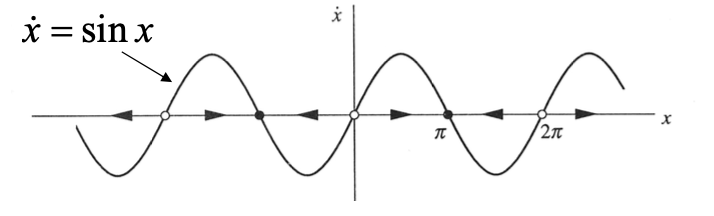
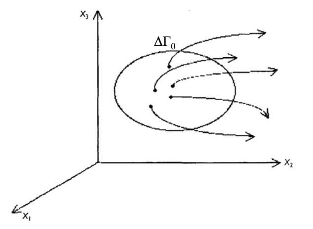

# 2 Dynamical systems with finite number of degrees of freedom

!!! abstract "Objectives"
    - 相空间表示（定性分析的基础）
    - 中心流形理论（central manifold），如何降维
    - 不变流形（invariant manifold），吸引子与排斥子
    - 保守系统 / 耗散系统
    - 稳定性的概念

## 2.1 Phase space representation

### 1D Example

Consider a dynamical system

$$
\frac{d x}{d t} = \sin x
$$

Initial condition: $x(0) = x_0$.

#### Analytical method

The general solution is

$$
t = \int \frac{d x}{\sin x} = - \ln \left| \csc x + \cot x \right| + C
$$

plug in I.C.,

$$
t = \ln \left|\frac{\csc x_0 + \cot x_0}{\csc x + \cot x} \right| \implies x(t) = 2 \arctan \left[ \tan \frac{x_0}{2} e^{-t} \right]
$$

- :thumbsup: Advantage: given i.c., one can calculate the state of the system at any time $t$.
- :thumbsdown: Disadvantage: **lack global view**

#### Geometry method

!!! info "Phase space representation"
    For a dynamical system with $n$ variables, define a $n$-dimensional orthogonal space: $(x_1, x_2, \ldots, x_n)$, so that every **state** of the system $\vec{x}$ corresponds to a **point** in this phase space, vice versa.

    The **evolution** of the dynamical system $\vec{x}(t)$ will uniquely correspond to a **trajectory** in the phase space.

    For each trajectory, define a tangential velocity vector $\vec{v} = (v_1, \ldots, v_n)$ {++except fixed points++}

 

## 2.4 Conservative and dissipative systems

由于不确定性，实验测量得到的状态不是精确的一个点，而是一个小区域 $\Delta \Gamma_0$. 根据 $\Delta \Gamma_t$ 随时间变化的行为，可以把系统分为两类：保守系统和耗散系统。

- 保守系统：体积元 $\Delta \Gamma_t$ 不随时间变化
- 耗散系统：体积元 $\Delta \Gamma_t$ 随时间减小

!!! tip "保守系统也可能是不可预测的（混沌的）！"
    $$
    \left \{
        \begin{aligned}
            \frac{d X}{d t} &= \omega_0 X \\
            \frac{d Y}{d t} &= - \omega_0 Y
        \end{aligned}
    \right. \implies
    \left \{
        \begin{aligned}
            X &= X_0 e^{\omega_0 t} \\
            Y &= Y_0 e^{- \omega_0 t}
        \end{aligned}
    \right.
    $$

### Mathematical definition of conservative and dissipative systems

流体的质量守恒方程（无源/汇）：

$$
\frac{\partial \rho}{\partial t} + \nabla \cdot (\rho \vec{v}) = 0
$$

对于动力系统 $\vec{v} = d \vec{X} / d t = \vec{f}(\vec{X})$，定义{++相空间中的概率密度++}：

$$
\begin{equation} \label{eq:prob-density-phase-space}
    \rho = \frac{1}{N_{\text{tot}}} \lim_{\Delta \Gamma \to 0} \frac{\Delta N}{\Delta \Gamma}
\end{equation}
$$

- $\Delta \Gamma$：相空间的小体积元
- $\Delta N$：体积元中的状态数
- $N_{\text{tot}}$：相空间中的总状态数

> 有点借鉴统计物理的概念

由质量守恒方程可得

$$
\frac{\partial \rho}{\partial t} = - \nabla \cdot (\rho \vec{v}) = - \partial_i (\rho f_i) = - \rho \partial_i f_i - f_i \partial_i \rho
$$

概率密度的全导数

$$
\frac{d\, \rho(\vec{X}, t)}{d t} = \frac{\partial \rho}{\partial t} + \frac{\partial \rho}{\partial X_i} \frac{d X_i}{d t} = \frac{\partial \rho}{\partial t} + f_i \partial_i \rho
$$

代入 $\partial \rho / \partial t$，

$$
\frac{d \rho}{d t} = - \rho \partial_i f_i = - \rho \nabla \cdot \vec{f}
$$

所以有

$$
\begin{equation}
    \frac{d \ln \rho}{d t} = - \nabla \cdot \vec{f}
\end{equation}
$$

上式对时间积分：

$$
\ln \frac{\rho(t)}{\rho(0)} = - \int_0^t \nabla \cdot \vec{f}(\vec{X}(t')) dt'
$$

对时间平均：

$$
\frac{1}{t} \ln \frac{\rho(t)}{\rho(0)} = - \frac{1}{t} \int_0^t \nabla \cdot \vec{f}(\vec{X}(t')) dt' \xrightarrow{t \to +\infty} - \left\langle \nabla \cdot \vec{f} \right\rangle_t
$$

