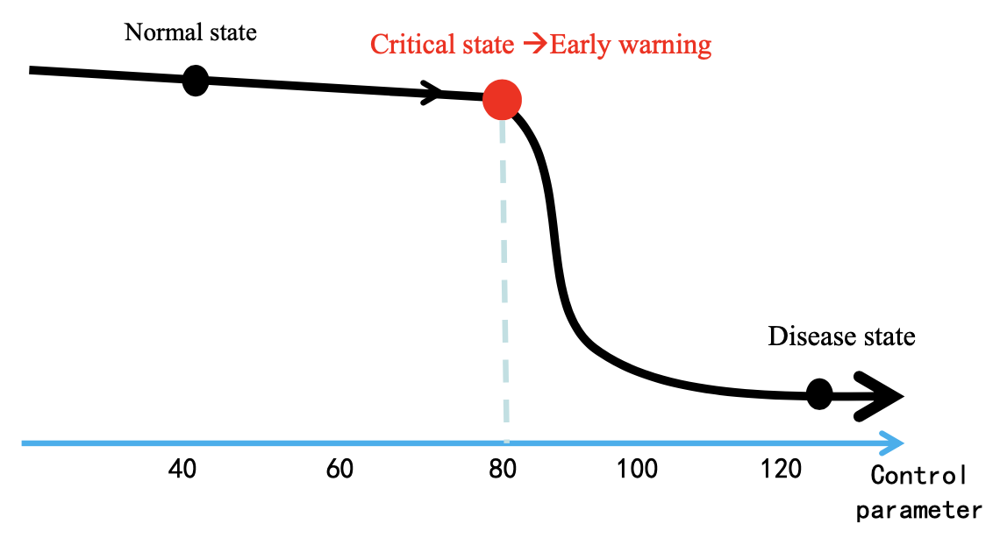
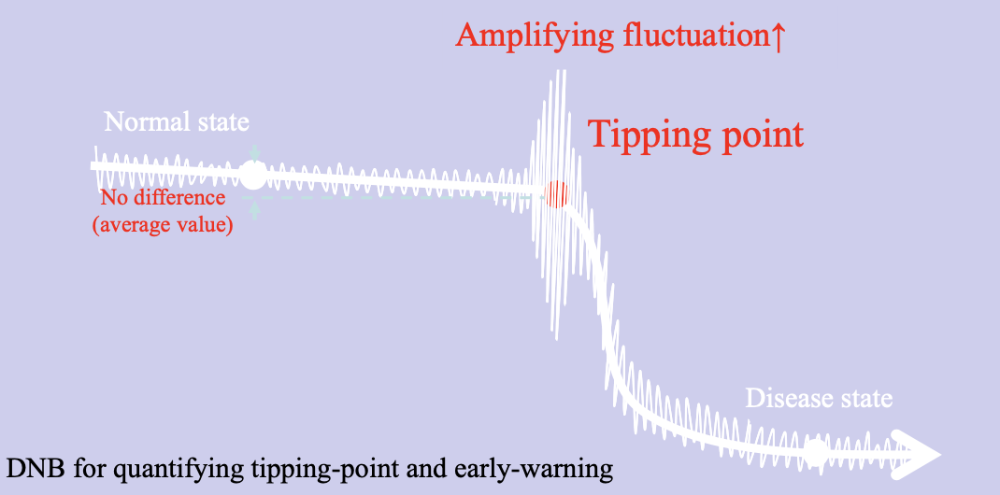
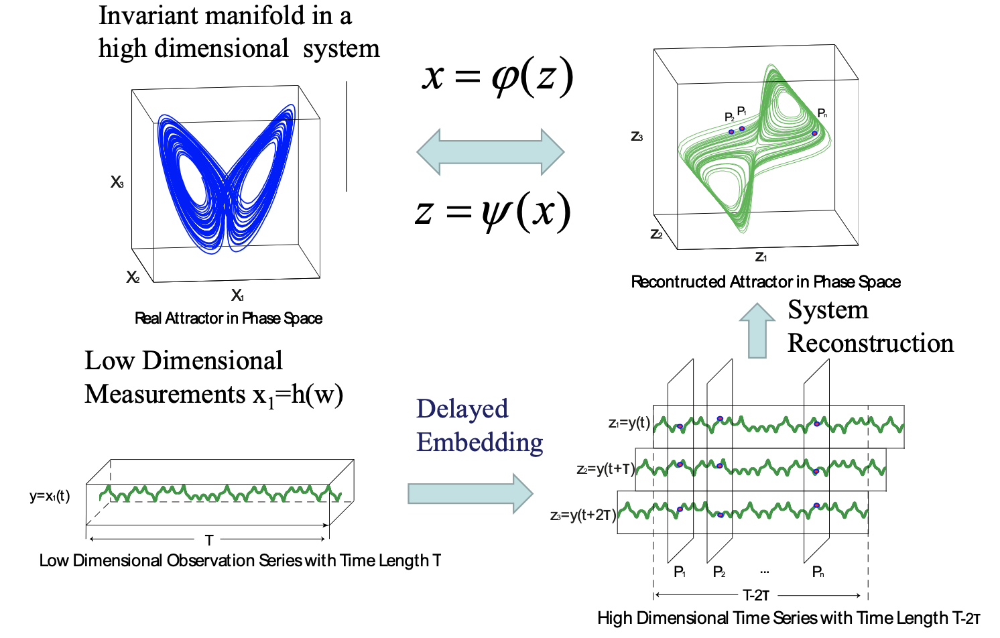

# 4 Nonlinear Analysis & Normal forms

!!! abstract "Objectives"
    - Discuss the concept of **mode resonance**: different dynamical modes in a system may interact, leading to new behavior of the system.
    - Introduce **multiple-scale perturbation analysis**: how to develop the amplitude equation that governs the new behavior.
    - **Normal form development**: using multiple-scale analysis to categorize nonlinear systems based on the symmetry and the dimension of the system.
    - Introduce the technique of **nonlinear transformation**: how to transform a nonlinear system into a simpler form that retains the essential dynamics.
      - From this point, we will unveil the concept of mode resonance.

## 4.1 Perturbation analysis and mode resonance

### Perturbation analysis

对于弱非线性动力系统

$$
\frac{\mathrm{d} \vec{X}}{\mathrm{d} t} = L(\lambda) \vec{X} + \epsilon \vec{h}(\vec{X}, \lambda), \quad \epsilon \ll 1
$$

非线性项 $\epsilon \vec{h}(\vec{X}, \lambda)$ 可视为线性系统的微扰。假设微扰项只能成比例地改变线性系统的解（**proportion response**），则可以使用微扰分析来研究非线性系统的解。

### Perturbation technique

!!! example "二次非线性项"
    $$
    \frac{\mathrm{d} X}{\mathrm{d} t} + X = \epsilon X^2, \, 0 < \epsilon \ll 1
    $$

## 4.2 Multiple-scale perturbation analysis

### General solvability condition

!!! note "Solvability condition"
    To avoid secular terms appearing in the solution of the perturbation equations, one must set the resonance terms in $\vec{q}_i$ to zero.

!!! note "Fredholm alternative / Solvability condition"
    1.  定义伴随算符 $L^\dagger$：
        $$
        \braket{L^\dagger \vec{X}, \vec{Y}} = \braket{\vec{X}, L \vec{Y}}, \quad L_{ij}^\dagger = L_{ji}^*
        $$
    2.  计算 $L^\dagger$ 的非平凡零空间：
        $$
        L^\dagger \vec{u}^\dagger = 0
        $$
    3.  没有久期项的一个必要条件是，$L^\dagger$ 的非平凡零空间与微扰方程的右边项 $\vec{q}_i$ 正交：
        $$
        \braket{\vec{u}^\dagger, \vec{q}_i} = 0
        $$
        这样 $\vec{q}_i$ 中的共振项就会被消除，从而避免久期项的出现。
    

## 4.3 Normal form development

!!! info "Conditions"
    1. 在相空间中，状态位于动力系统的{++驻点附近++}，可以使用微扰分析（可以把非线性项视作微扰）
    2. 在控制参数空间中，系统处于{++分岔点附近++}，可以在低维中心流形分析系统的行为

    也就是系统是弱非线性的（weakly nonlinear dynamical system）

### Analysis procedure

先从一般形式出发，

$$
\frac{\mathrm{d} \vec{X}(\lambda)}{\mathrm{d} t} = \vec{f}(\vec{X}, \lambda)
$$

系统的驻点为 $\vec{X}_s$. 将微扰方程分离为线性项和非线性项：

$$
\frac{\mathrm{d} \vec{x}(\lambda)}{\mathrm{d} t} = L(\lambda) \vec{x} + \vec{h}(\vec{x}, \lambda), \quad \vec{X} = \vec{X}_s + \vec{x}
$$

## *非线性动力学在生命系统中的应用

### Dynamic Network Biomarker

复杂的高维动力系统在临界点附近，只有一两维起决定性作用。

假设：病态是健康态（稳态）的失稳，这个过程可以用非线性动力学来描述。

先考虑一维分岔系统。叉型分岔是结构不稳定的，必须保持镜像对称性。所以主要考虑 Saddle-Node 分岔。但是生命系统大多没有数学模型，没法直接使用分岔理论。只有数据，怎么办？

:point_right: 利用临界慢化现象！

> 在临界点附近，perturbation 的 decay 会变慢，对特定方向上的噪声不敏感

测量协相关性，model-free

### Delay Embedding

:question: Question: 我们无法测量到高维系统的所有变量，如何在相空间中重构吸引子（attractor）？

先考虑最简单的一个例子。二维系统有极限环解，但是 $y$ 变量无法测量到。如果观察 $x$ 变量的时间序列，显然是振荡的。我们可以用 $x$ 的延迟变量 $x(t-\tau)$ 来构造一个二维相空间 $(x(t), x(t-\tau))$，重构出来的闭合轨道与原来的极限环是同构的（拓扑性质相同）。

比方说，原先 $x$-$y$ 相空间中的极限环是一个圆，那么 $x(t)$ 就是一个正弦函数，$(x(t), x(t - \pi/2))$ 相空间中的轨道也是一个圆。不是 $\pi/2$ 的话可能是椭圆，但也是和原来的极限环同构的。

:bulb: 我们可以从单变量的长时间序列中重构出高维系统的吸引子。

